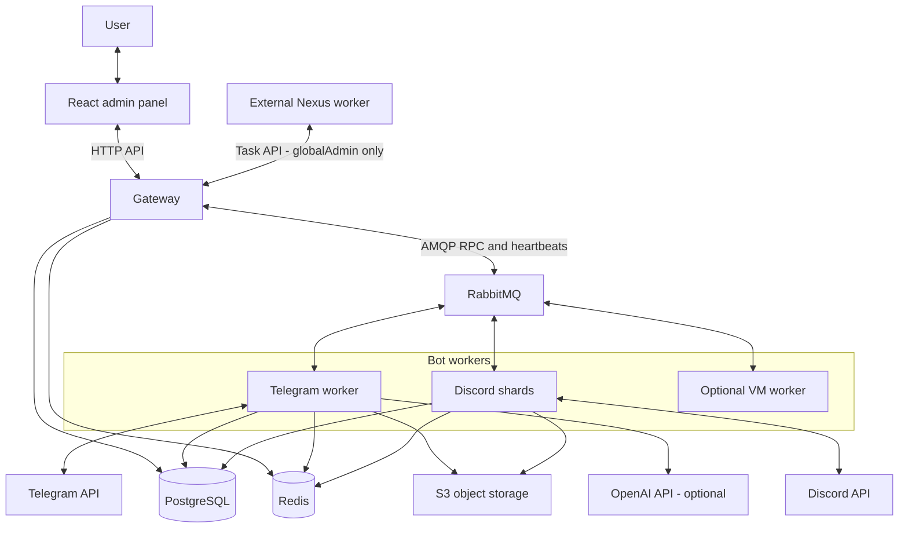

# Lisa

Lisa is a modular Telegram and Discord bot with a web admin panel, message
publishing, OpenAI chat and image commands, and a durable queue for Nexus tasks.

- [Admin panel](https://lisa.zero-team.pro)
- [Project context and Nexus planning hub](PROJECT_CONTEXT.md)
- [Bot services](bot/README.md) and [admin development](admin/README.md)

## Architecture

The diagram source lives here in Markdown. GitHub renders Mermaid automatically;
edit this block when the service topology changes. No image generator, API key,
or separate binary image is required.



PostgreSQL stores CMS data, identities, AI usage and balances, and the durable
Nexus queue, attempts, audit, and notification outbox. Redis handles transient
state and one-time authentication/link tokens. RabbitMQ carries service requests
and heartbeats; it does not replace the durable task queue in PostgreSQL.
S3 stores uploaded assets. The optional VM worker manages Docker-based services.
Ingress and TLS are managed outside Lisa's Compose stack.

## Commands and message formatting

Use `/help` and `/ls` in Telegram, or `-help` and `-ls` in Discord (with the configured server prefix), to inspect
commands available on that transport. Modules determine command availability;
OpenAI commands are currently registered for Telegram only.

| Telegram command                          | Purpose                                                                     |
| ----------------------------------------- | --------------------------------------------------------------------------- |
| `/ai <request>`                           | OpenAI chat; `Lisa <request>` and `Лиза <request>` also work                |
| Reply to an AI answer                     | Continue with the immediately preceding answer as context                   |
| `/img <prompt>`                           | Generate one PNG image                                                      |
| `/aiBalance`                              | Show Lisa's internal AI balance                                             |
| `/mode lisa`, `/mode nexus`, `/mode exit` | Enable or leave conversational mode                                         |
| `/nexus <task>`                           | Submit a task to the external Nexus worker; private linked globalAdmin only |

`/ai` can include a text document up to 100,000 bytes; with a document its answer
is returned as a Markdown file. Image attachments are passed as vision inputs.
Chat history is limited to the replied-to answer, rather than a full stored conversation.

The OpenAI module is maintained as an optional integration. It uses GPT-6 Sol
for chat, GPT-6 Luna for tool selection, and GPT Image 2.5 Flare for `/img`.
See [OpenAI support and offline validation](docs/openai-support.md) for compatibility,
billing, configuration, and limitations. Nexus runs independently of this OpenAI
API key and balance.

Markdown, CMS Slate content, and incoming Telegram entities are normalized into
one message document. Telegram uses native entities; Discord uses its own
Markdown renderer. See [message formatting](docs/message-formatting.md) and
[the development acceptance checklist](docs/message-formatting-dev-check.md).

## Legacy GI rater usage (Discord)

```text
-rate <image/url> [lvl=<level>] [<stat>=<weight> ...]
```

The bundled rater service is deprecated and commented out in Compose. These
commands require a separately configured, reachable `RATER_HOST`.

### Default Weights

ATK%, DMG%, Crit - 1 \
ATK, EM, Recharge - 0.5 \
Everything else - 0

### Options

#### Level

Compare to specified artifact level (defaults to parsed artifact level)

```text
-rate lvl=20
```

#### Weights

Set custom weights (valued between 0 and 1)

```text
-rate atk=1 er=0 atk%=0.5
```

\<stat> is any of HP, HP%, ATK, ATK%, ER (Recharge), EM, PHYS, CR (Crit Rate), CD (Crit Damage), ELEM (Elemental DMG%), Heal, DEF, DEF%

## Development

If you need help or want to contribute, feel free to join [Discord Server](https://discord.gg/2rvxaQWj).

Public machine-to-machine endpoints follow domain-scoped URL versioning. See
the [HTTP API versioning standard](docs/api-versioning.md) before adding or
changing an API contract.

The frozen Telegram↔Lisa↔Nexus task queue contract is documented in
[`docs/nexus-task-api.md`](docs/nexus-task-api.md). Telegram users submit with
`/nexus <task text>` in a chat configured in `NOTIFY_TOKENS`; authenticated
Nexus workers use `/tasks/v1`. `/mode nexus` accepts ordinary messages, and
replying to a Nexus result continues its session. See
[conversation behavior and dev checks](docs/nexus-conversations.md). Configure the same mapping on the gateway and
Telegram service. The gateway recovers expired leases and retries persisted
Telegram status notifications in the background. Telegram submission requires
a linked `AdminUser` with role `globalAdmin` in their private chat; each task
request is audited. Task API tokens must map to that same private globalAdmin
identity, and every operation rechecks the database role.
Workers can report per-attempt model/token/duration metadata, visible in Telegram
results and through `GET /tasks/v1/:id`.

## Service status

The public service-status page is available at `/status` on the admin host. It
refreshes automatically and does not require a Lisa administrator account.

Its data comes from the public, read-only `GET /status/v1` gateway endpoint.
The response reports the current state of the gateway, configured bot workers,
PostgreSQL, Redis, RabbitMQ, and known external providers. Worker availability
is determined from periodic RabbitMQ heartbeats. External provider checks are
listed as `unknown` until an active check is implemented and do not affect the
overall Lisa status.

The endpoint deliberately omits internal addresses, configuration values, and
raw error messages. An unversioned `/status` API route is not exposed.

### Setup

```bash
cp .env.example .env
# Set STAGING=dev and use separate development credentials and data paths
# Fill required .env values described below; OpenAI may be left empty
make setup
make dev-up
```

The repository pins Yarn 4.17.1 through the `packageManager` field in both
projects. Use Corepack (`corepack enable`) instead of installing Yarn globally;
Corepack will select the pinned version automatically. `make setup` installs
both projects with immutable Yarn lockfiles.

`make dev-up` starts the local Docker stack with RabbitMQ 3.13.4 Management.
Local RabbitMQ credentials and a dedicated mutual-TLS CA, server certificate,
and client certificate are generated on first use under the ignored
`.local/rabbitmq` directory. They are never shared with production. RabbitMQ
Management is available at <http://127.0.0.1:15672>; the generated username and
password are stored in `.local/rabbitmq/compose.env`.

```bash
make dev-logs # follow Lisa and RabbitMQ logs
make dev-down # stop the local stack
```

Production deployments continue to use only `docker-compose.yml` and the
production `RABBITMQ_URI`. The local RabbitMQ service and credentials exist only
in `docker-compose.local.yml`.

`make setup` enables the repository-managed pre-commit hook. Before each
commit, staged files are formatted with the same Prettier configuration used
by VS Code. Tests and typechecks are not run automatically by Git hooks.

### Local checks

```bash
make format       # rewrite files with Prettier
make test         # fast unit tests
make check        # formatting + typecheck + unit tests
make ci           # full bot CI check with coverage
make docker-build # slow gateway image build used by release
```

Use `make test` during development, `make check` when you want a local quality gate, and
`make ci docker-build` when changing dependencies, Docker configuration, or
release-sensitive code. GitHub Actions runs the fast quality gate and Docker
build for branches and pull requests; release publishes images only after the
full check succeeds.

### .env variables

#### COMPOSE_PROFILES

Leave only what you need.

**admin** - Admin panel (React app) \
**vm** - Optional Docker service worker \
**monitor** - PostgreSQL diagnostics exporter \
**telegram** - Telegram bot

#### DISCORD_TOKEN, DISCORD_CLIENT_ID, DISCORD_CLIENT_SECRET

Create application and bot for it on [Discord Developer Portal](https://discord.com/developers/applications).

#### MAIN_CHANNEL_ID

Discord channel id for system messages. Your bot should have privileges to send messages to this channel.

#### Private Nexus TikTok capture

After migration 7, a standalone first-line TikTok video URL in an authorized
private `/nexus` request or `/mode nexus` automatically selects capture. No
feature flag is required. Success and duplicates are silent; only errors are
delivered. A compatible Mac worker downloads the video. Old workers leave capture
jobs queued. See [private TikTok capture](docs/nexus-tiktok-capture.md).

#### NOTIFY_TOKENS

Optional comma-separated `token:chatId` pairs for the public machine-to-machine
`POST /notify/v1` endpoint. When unset, the endpoint rejects every request with
`401`. The same mapping scopes `/tasks/v1` to one owning Telegram chat; no
separate task token or chat ID request field is used. Messages are delivered as
plain text through the Telegram service.

```bash
curl -X POST "https://${API_HOST}/notify/v1" \
  -H "Authorization: Bearer <token>" \
  -H 'Content-Type: application/json' \
  -d '{"text":"Notification text","source":"nexus-automation"}'
```

#### OPENAI_API_KEY

Optional. Leave unset or empty to disable paid OpenAI generation. Lisa can run
without this key; `/ai` and `/img` require it and a positive internal balance. Lisa's internal
AI balances do not represent the provider account balance or fund the OpenAI
account. No model-list or generation request is made at startup.

#### OCR_SPACE_API_KEY

Optional, for the legacy artifact rater.
Go to <https://ocr.space> and get an API key.

#### RATER_HOST

Leave default value for development.

#### \*\_HOST and \*\_HOST_LE

Host names used by deployments and admin build configuration. The external
reverse proxy and TLS setup are not provisioned by this repository.
